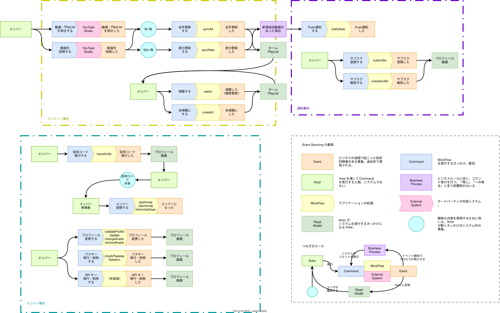

<samp>

  

<h1 align="center">Soko</h1>

<!-- Badge -->

<!-- About this Project -->

NWU の創作を「置く」場所

 

## 🌏 URL

| Name       | URL                      |
| :--------- | :----------------------- |
| Production | https://soko.nw-union.net |
| Local      | http://localhost:5173    |

 

## 🎫 Event Storming

 

## 🔄 WorkFlows / Queries

Web 層（`pages/`・`routes/`・`middleware/`・`crons/`・`auth.ts`）は、`schema/service.ts` の WorkFlows と Queries だけを呼ぶ。コンテキスト（イベストの集約）は Content・Member・Notification の 3 つで、それぞれ 2 つに分ける。

- **WorkFlows**（コマンド）: 状態を変える。イベストの「〜する」。実装は `domain/<Context>/` 以下の `workflow.ts`。`container()` の `contentWorkFlows`・`memberWorkFlows`・`notificationWorkFlows` から呼ぶ。全 20 本
- **Queries**（Read Model）: 読むだけ。戻り値は `…View` / `…Dto`。実装は `domain/<Context>/` 以下の `query.ts`。`container()` の `contentQueries`・`memberQueries`・`notificationQueries` から呼ぶ。全 8 本

better-auth の手前のチェック（`validate〜`・`checkPasskeyDeletion`）と登録の入口の `startInvite` は、書き込みの前提を確かめるコマンドの一部なので WorkFlows に置く。

### Member / Invite（招待）

| 種類 | 名前 | 内容 |
| :-- | :-- | :-- |
| WF | `issueInvite` | 招待を発行する。上限なら ConflictError。トークンはここで 1 回だけ返す |
| WF | `revokeInvite` | 未使用の招待を取り消す（枠が戻る）。使用済み・他人の招待・存在しない ID は何もしない |
| WF | `startInvite` | 登録の入口。トークンが今使えるか確かめ、正規化したトークンを返す |
| WF | `claimInvite` | 登録（ユーザー作成）の直前に招待を使用済みにする。同時に使っても成功は 1 回だけ |
| WF | `linkInvitedUser` | 登録の直後に、使用済みにした招待へ作られたユーザーを結び付ける |
| Qry | `listInvites` | 自分が発行した招待の一覧と、あと何回発行できるか |

### Member / Profile（プロフィール）

| 種類 | 名前 | 内容 |
| :-- | :-- | :-- |
| WF | `validateProfileUpdate` | プロフィール更新の入力を確かめる。名前は前後の空白を除く |
| WF | `validateSignUp` | 登録の入力を確かめる。メールは使い捨てのものだけ |
| WF | `changeAvatar` | アイコン画像を差し替える。古い画像は消す（消せなくても成功） |
| WF | `removeAvatar` | アイコン画像を外して、頭文字の表示に戻す |
| WF | `cleanupDeletedUser` | 退会後の後始末（画像・未使用の招待・通知の購読・視聴記録） |
| WF | `checkPasskeyDeletion` | パスキーを削除してよいか確かめる。ログインし直した直後でなければ Forbidden、最後の 1 つなら ValidationError |
| Qry | `getDisplayUser` | 画面に出すユーザー（表示に必要な最小限） |
| Qry | `hasPasskey` | パスキーを作ったか。未作成なら /welcome から出さない |

### Content（動画の同期・ホーム・視聴記録）

| 種類 | 名前 | 内容 |
| :-- | :-- | :-- |
| WF | `syncAll` | 全件の同期。全動画を取り直して反映し、紐付けを作り直す。どのプレイリストにもない動画は消す。YouTube から先にすべて取得し、1 つでも失敗したら DB は変えない |
| WF | `syncNew` | 差分の同期。プレイリストに増えた動画だけを足す。更新・並び替え・削除はしない |
| WF | `createPlaylist` | 同期するプレイリストを足す。同じ ID が既にあれば ConflictError |
| WF | `deletePlaylist` | プレイリストを消す（動画との紐付けも消える） |
| WF | `watch` | 視聴を記録する。登録済みの動画だけ。何度送っても 1 件 |
| WF | `unwatch` | 視聴記録を消して未視聴に戻す |
| Qry | `listPlaylists` | 同期の対象のプレイリストの一覧（並び順） |
| Qry | `getHomeFeed` | ホームに並べる動画（New の候補・ランダム・プレイリストごと） |
| Qry | `getBadgeCount` | アイコンのバッジに出す、未視聴の New の本数 |
| Qry | `countUnwatchedNew` | ユーザーごとの未視聴の New の本数（通知のバッジ用） |

### Notification（プッシュ通知）

| 種類 | 名前 | 内容 |
| :-- | :-- | :-- |
| WF | `subscribe` | 購読を保存する。1 人 10 件まで（超えたら古いものから削除） |
| WF | `unsubscribe` | 購読を消す（通知オフ・ログアウト時） |
| WF | `notifyNew` | 未通知の動画を通知済みにして、最近のものを全購読者に 1 通で知らせる。差分の同期で動画が増えたとき、ポリシー（`server/policy.ts`）が呼ぶ。全件の同期の cron も取りこぼしを拾うために呼ぶ |
| Qry | `getPublicKey` | 購読用の VAPID 公開鍵を取得。鍵がなければ null |

 
 

--

Happy hacking 💛
</samp>

